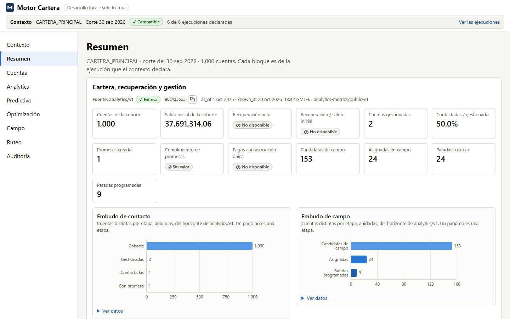
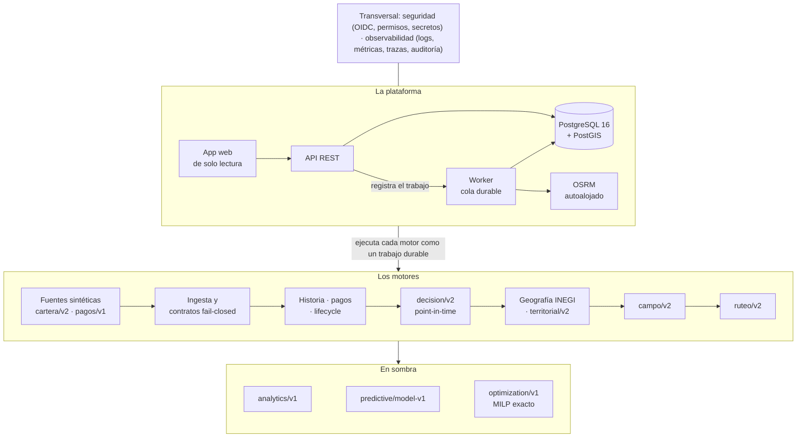
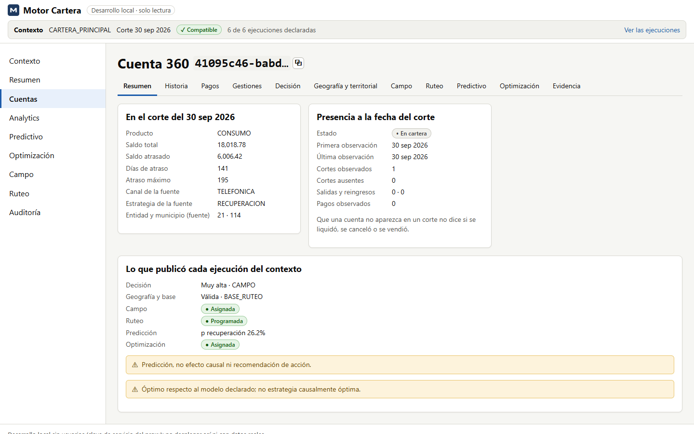
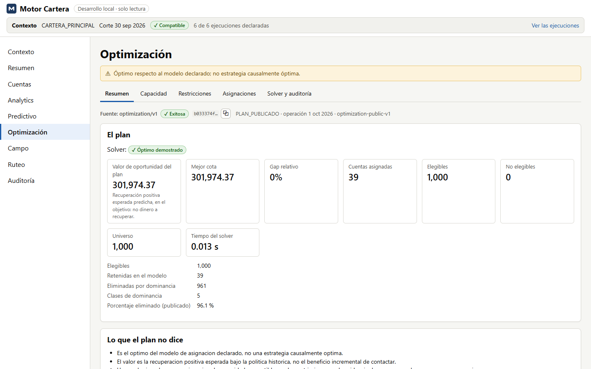

# motor-cartera

Una plataforma de inteligencia de cobranza (*collection intelligence*) sobre una cartera de crédito
al consumo **sintética**: certifica cada archivo contra su contrato, reconstruye la historia de cada
cuenta y sus pagos, decide **point-in-time** y de forma explicable, ubica cada cuenta en la
geografía oficial, planea el trabajo de campo y sus rutas por calle, y describe, predice y optimiza
en sombra. Una API, un worker sobre una cola durable y una app web de solo lectura, con seguridad y
observabilidad de producción.

[](https://github.com/israelcervantes31416/motor-cartera/actions/workflows/ci.yml)
[](https://github.com/israelcervantes31416/motor-cartera/actions/workflows/codeql.yml)
[](https://github.com/israelcervantes31416/motor-cartera/releases/latest)
[](pyproject.toml)
[](LICENSE)



## Qué resuelve

Una cartera de crédito llega en archivos de sistemas distintos, con encabezados que cambian sin
aviso, duplicados, saldos imposibles y claves geográficas incompletas. Sobre esos archivos alguien
decide a quién contactar, por qué canal y en qué orden; si el dato entra mal, la decisión sale mal,
y la decisión se ejecuta.

motor-cartera es la cadena completa, de punta a punta, con una regla: **fail-closed**. Nada entra
sin pasar su contrato, y lo que no entra dice por qué; nada se publica a medias; cada resultado se
explica hasta el archivo y la fila de donde salió. Es preferible no producir salida a producir
salida incorrecta.

**Ningún dato real entra al repositorio.** Las carteras, los pagos y la cobranza los produce su
generador sintético, determinista por semilla; la cartografía del INEGI y las redes de
OpenStreetMap son públicas y se descargan, verificadas por su SHA-256, fuera del repositorio.

## Arquitectura



Una API REST (FastAPI) registra el trabajo y responde; un **worker** lo ejecuta desde una **cola
durable en PostgreSQL** (lease, latido y reintentos), y cada motor publica todo o nada. Todo el
estado vive en **PostgreSQL 16 con PostGIS 3.5** y en un almacén de artefactos por contenido; el
ruteo por calle lo responde un **OSRM** autoalojado; la **app** (React y TypeScript) lee por un
proxy de solo `GET`. Encima de todo, la seguridad y la observabilidad del compose de producción.
El detalle, con los componentes, el almacenamiento y el linaje, está en
[docs/architecture.md](docs/architecture.md).

## Capacidades

| Capa | Qué hace | Documento |
|---|---|---|
| Ingesta y contratos | `cartera/v1`, `cartera/v2` (93 columnas, con CARRIER) y `pagos/v1` (23), con estructura exacta; cada original en un almacén por contenido y su dataset conformado en Parquet | [fuentes.md](docs/fuentes.md) |
| Historia y Cuenta 360 | Cuentas canónicas, cortes, snapshots inmutables y pagos observados; qué le pasó a una cuenta a través de sus cortes | [historia.md](docs/historia.md) |
| Motor de pagos | Duplicados exactos, coincidencias ambiguas y reversos, interpretados sin tocar lo observado, y conciliados con su cuenta | [motor_pagos.md](docs/motor_pagos.md) |
| Lifecycle y atribución | Gestiones, promesas y convenios como eventos que solo se agregan; la evaluación de promesas y una atribución operativa que no afirma causalidad | [lifecycle.md](docs/lifecycle.md) |
| Decisión | `decision/v1` por reglas, y `decision/v2` point-in-time (`as_of` y `known_at`) con 43 features y cada decisión explicada | [decision_v2.md](docs/decision_v2.md) |
| Geografía y territorio | La referencia municipal del INEGI en PostGIS, el municipio espacial de cada cuenta y la base operativa que le corresponde | [geografia.md](docs/geografia.md) |
| Campo y ruteo | La capacidad declarada de cada gestor (`campo/v2`) y sus rutas por calle con OSRM (`ruteo/v2`), con jornadas y turnos partidos | [ruteo_v2.md](docs/ruteo_v2.md) |
| Analytics | Métricas, cohortes y embudos point-in-time, con un catálogo de 87 métricas y supresión de celdas pequeñas | [analytics.md](docs/analytics.md) |
| Predictivo | Cuatro modelos auditables (GLM) con un manifiesto temporal, calibración, backtesting y drift, en sombra | [predictivo.md](docs/predictivo.md) |
| Optimización | Un MILP lexicográfico exacto (HiGHS) que solo publica un óptimo demostrado, en sombra | [optimizacion.md](docs/optimizacion.md) |
| App | Contexto explícito, resumen, explorador de cuentas, Cuenta 360 y una pantalla por motor, sin datos personales ni coordenadas | [app.md](docs/app.md) |
| Producción | TLS, OpenID Connect, permisos por ruta, secretos como archivos, observabilidad, alertas, respaldos y restauración | [production.md](docs/production.md) |

| Cuenta 360 | Optimización |
|---|---|
|  |  |

## Qué lo distingue

- **Point-in-time de verdad.** `decision/v2`, analytics y predictivo deciden con lo ocurrido hasta
  `as_of` y lo conocido en `known_at`: nada recibido después cambia un resultado ya publicado.
- **Contratos que fallan cerrados y linaje inmutable.** Cada original se guarda por su SHA-256, y
  de cada resultado se llega a su ejecución, a sus entradas declaradas y a la fila de origen.
- **Una cola durable sin broker.** `FOR UPDATE SKIP LOCKED`, lease y latido sobre PostgreSQL: si
  un worker muere, otro retoma su trabajo, y la publicación no se repite.
- **Pagos canónicos y lifecycle operativo**, separados de lo observado: interpretar no es
  modificar, y asociar no es atribuir causalidad.
- **Decisiones explicables.** Cada decisión guarda sus features, sus reglas y sus hashes, y se
  vuelve a verificar al consultarla.
- **Un núcleo puro por motor.** Las reglas no saben de bases ni de HTTP; su ejecución en
  PostgreSQL, por conjuntos, se prueba contra ellas, y reconstruir una capa da los mismos hashes.
- **Geografía y rutas reales sobre datos sintéticos**: la cartografía oficial en PostGIS y OSRM
  autoalojado, sin geocodificar ni llamar a un servicio externo.
- **Validación temporal en predictivo** (split con purga y walk-forward) y un **MILP exacto** que
  no publica un plan sin su prueba de optimalidad.
- **Una app de solo lectura**, y una producción con OpenID Connect, permisos por ruta,
  observabilidad sin datos personales y restauración ensayada.
- **Una versión estable que se puede verificar.** Semantic Versioning sobre una superficie escrita
  ([docs/versioning.md](docs/versioning.md)), Python 3.12 a 3.14 probado en cada run, y releases que
  se niegan antes de publicar y llevan la atestación de procedencia de cada asset.

## Un ejemplo: una decisión explicada

Cada decisión dice por qué, regla por regla, con el campo que leyó y su valor. Una cuenta con 65
días de atraso y 62,000.00 de saldo, decidida por `decision/v1`
(`GET /decisiones/{decision_run_id}/cuentas`):

```json
{
  "cliente_unico": "CU…",
  "segmento": "MORA_MEDIA",
  "prioridad": "MUY_ALTA",
  "canal_recomendado": "CAMPO",
  "motivos": [
    {"codigo": "MORA_31_90", "campo": "dias_atraso", "valor": "65"},
    {"codigo": "SALDO_ALTO", "campo": "saldo_total", "valor": "62000.00"},
    {"codigo": "PRIORIDAD_MUY_ALTA", "campo": "prioridad", "valor": "MUY_ALTA"},
    {"codigo": "CANAL_CAMPO", "campo": "canal_recomendado", "valor": "CAMPO"}
  ]
}
```

`decision/v2` va más lejos: guarda las 43 features de cada cuenta con su `feature_hash`, cada regla
con si aplicó, y su `decision_hash`; al consultar una cuenta, vuelve a aplicar la política a sus
features y verifica que da exactamente lo mismo ([docs/decision_v2.md](docs/decision_v2.md)).

## Lo que no es

- **No usa datos reales**, ni sus resultados describen una cartera real.
- **No afirma causalidad.** Analytics describe; una predicción no es un efecto causal; un plan es
  óptimo respecto a su modelo declarado, no causalmente.
- **No ejecuta acciones de cobranza.** Ni llamadas, ni mensajes, ni visitas: decide, planea y
  muestra; la app es de solo lectura.
- **No está desplegado en la nube.** Hay una referencia de Google Cloud en OpenTofu, validada en el
  CI y nunca aplicada ([docs/cloud-gcp.md](docs/cloud-gcp.md)).

## Evidencia

| Evidencia | Resultado |
|---|---|
| Pruebas de Python (pytest, contra PostgreSQL con PostGIS) | 3,951 pasan y 1 se omite en el CI; 97 % de cobertura de líneas |
| Pruebas de la app (Vitest) | 136 pruebas en 18 archivos; 90.8 % de cobertura de sentencias |
| Playwright con axe-core | 55 pruebas contra el compose de desarrollo y 62 contra el de producción, con usuarios de Dex |
| Compatibilidad de Python | En cada run, en 3.12, 3.13 y 3.14: el entorno del lock, cada módulo, la línea de comandos, 772 pruebas puras y el mismo OpenAPI, byte por byte |
| Núcleos puros contra su SQL | Cada motor tiene un núcleo puro y su ejecución por conjuntos en PostgreSQL; una prueba compara los dos cuenta por cuenta, y los goldens se calculan a mano |
| Migraciones | En cada run suben desde cero, coinciden con los modelos (`alembic check`), bajan y vuelven a subir |
| Contrato de la app | Los tipos de la app se generan del OpenAPI de la API; el CI falla si alguien no los regeneró |
| Prueba de humo de punta a punta | En cada run: de la cartera sintética al ruteo, la historia, los pagos, el lifecycle, `decision/v2`, la geografía, campo, ruteo por calle, analytics, predictivo y optimización, por HTTP |
| Respaldo y restauración | En cada run: el respaldo de la base y del almacén se restaura en un entorno nuevo y se valida |
| Simulacros y carga | En cada run, la caída de la base, la API, el worker, OSRM y la telemetría, y una carga corta con k6 |
| Seguridad de la cadena de suministro | gitleaks sobre el historial, Trivy (lockfiles e imágenes), pip-audit, npm audit, CodeQL con cada alerta clasificada y un SBOM CycloneDX |
| Releases | El OpenAPI, los SBOM y su `SHA256SUMS`, con la atestación de procedencia de cada uno, publicados por un workflow que se niega antes de publicar ([cadena-de-suministro.md](docs/cadena-de-suministro.md#las-releases)) |
| Rendimiento | El perfil M (100,000 cuentas) cada semana, contra su línea base: una señal de regresión, no un objetivo de servicio ([rendimiento.md](docs/rendimiento.md)) |
| Tipos | Pyright: 0 errores en los 219 archivos de `src/motor_cartera` (standard; strict en 13 módulos) |
| Infraestructura como código | OpenTofu: `fmt`, `validate` y el plan de staging y production en cada run, sin credenciales; nunca aplicado |

Las cifras son del CI de `main`; cómo se prueba cada capa está en
[docs/desarrollo.md](docs/desarrollo.md#pruebas).

## Escala

**XL, 500,000 cuentas, es el escenario empresarial objetivo**; XXL, 1,000,000, es una prueba de
esfuerzo que solo se corrió sobre la ingesta. Algunas mediciones, en una máquina de desarrollo y
fuera del CI:

| Qué | Medido |
|---|---|
| Ingesta de una cartera XL (`cartera/v2`, zip) | 149 s y 930 MiB de memoria pico; la XXL, 283 s y 1,137 MiB |
| `decision/v2` de un corte de 465,999 cuentas, con todo su lifecycle | 199 s y 154 MiB |
| `analytics/v1` de una cohorte de 500,000 cuentas, por día en 30 días | 41.5 s |
| Scoring predictivo de 500,000 cuentas | 173 s |
| `optimization/v1` de 500,000 cuentas con `CAMPO` (408,204 variables) | 87.6 s, con el óptimo demostrado en cada nivel |
| `ruteo/v2` del plan XL (99,720 cuentas) contra la red real de Puebla | 16.8 s |

Cada benchmark, con su máquina, sus supuestos y su variación, está en
[docs/README.md](docs/README.md#benchmarks).

## Stack

| Capa | Tecnología |
|---|---|
| Backend | Python 3.12 (probado también en 3.13 y 3.14), FastAPI, SQLModel y SQLAlchemy, Alembic, Pydantic, Typer |
| Datos | PostgreSQL 16, PyArrow y Parquet, pandas, pandera |
| Optimización y modelos | SciPy con HiGHS (MILP), NumPy, GLM propios (logística L2, Tweedie, Platt) |
| Geoespacial | PostGIS 3.5, el Marco Geoestadístico del INEGI, OSRM v26.9.0 con OpenStreetMap |
| Frontend | React 19, TypeScript estricto, Vite, TanStack Query y Table, Recharts |
| Ejecución | Docker Compose, nginx, un worker sobre la cola durable |
| Seguridad | OpenID Connect con oauth2-proxy (Dex en local), PyJWT, una matriz de permisos |
| Observabilidad | OpenTelemetry, Prometheus, Alertmanager, Grafana, Jaeger |
| Infraestructura | OpenTofu (una referencia de Google Cloud, no desplegada) |
| CI | GitHub Actions: pytest, Vitest, Playwright, Pyright, ruff, CodeQL, Trivy, gitleaks, k6; releases con atestaciones de procedencia |

## Inicio rápido

Con Docker:

```bash
git clone https://github.com/israelcervantes31416/motor-cartera.git
cd motor-cartera
docker compose up --build -d --wait
docker compose exec api motor-cartera generar-oficial --destino datos --fecha-corte 2026-09-30
curl -H "X-API-Key: clave-local-de-desarrollo" -F "archivo=@datos/cartera_oficial_2026-09-30.xlsx" \
  -F contrato=cartera/v2 -F fecha_corte=2026-09-30 http://localhost:8000/corridas
```

Eso levanta PostgreSQL con PostGIS, aplica las migraciones y arranca la API, el worker y la app;
genera una cartera oficial sintética y la sube. La app queda en <http://localhost:8080> (solo en esa
máquina): se elige la cartera y su corte, y se abren sus cuentas y su Cuenta 360. La API y su
OpenAPI, en <http://localhost:8000/docs>.

La prueba de humo sube una cartera y sigue su flujo automático hasta el ruteo, con la verificación
de cada código HTTP; sus opciones recorren los demás motores
([docs/flujo_completo.md](docs/flujo_completo.md#la-prueba-de-humo)):

```bash
docker compose exec api motor-cartera generar --destino datos/humo.xlsx --semilla 7
python scripts/prueba_de_humo.py datos/humo.xlsx
```

- **El recorrido completo**, motor por motor, por la API y la línea de comandos:
  [docs/flujo_completo.md](docs/flujo_completo.md).
- **Sin Docker**, las pruebas y el CI: [docs/desarrollo.md](docs/desarrollo.md).
- **El compose de producción local** (TLS en `https://motor-cartera.localhost:8443`, usuarios de
  Dex, permisos, observabilidad y respaldos): [docs/production.md](docs/production.md).

## El repositorio

```text
src/motor_cartera/   El paquete: contratos, ingesta, cada motor (un núcleo puro y su ejecución
                     en PostgreSQL), la orquestación, la API (api/) y la línea de comandos (cli.py)
migraciones/         Las migraciones de Alembic
web/                 La app de solo lectura (React y TypeScript), su proxy y sus pruebas
tests/               pytest, contra PostgreSQL con PostGIS
scripts/             La prueba de humo, los benchmarks, el respaldo, los simulacros y los controles
infra/               La configuración del compose de producción y la referencia de Google Cloud
docs/                La documentación, con su índice en docs/README.md
```

## Seguridad

El compose de desarrollo no tiene usuarios: una clave de servicio que pone el proxy de la app, y la
app lo dice a la vista («Desarrollo local sin usuarios (clave de servicio del proxy); no desplegar
así ni con datos reales»). El de producción es otra cosa:

- un **edge** de TLS como única puerta, con límites por IP, CSP estricta y solo los `GET` de una
  lista blanca hacia la API;
- **OpenID Connect con PKCE** por oauth2-proxy, la sesión del lado del servidor y ningún token en el
  navegador; la API valida cada token ella misma;
- **cuatro permisos** y una matriz explícita de cada operación, que la API verifica al arrancar;
  claves de servicio guardadas por su hash;
- **configuración que falla cerrada**, secretos como archivos, un rol de base por servicio y
  contenedores sin raíz;
- respaldos verificados y restaurados ([docs/backups.md](docs/backups.md)), y la cadena de
  suministro fijada por digest y por SHA.

Los controles, en [docs/security.md](docs/security.md); el modelo de amenazas, en
[docs/threat-model.md](docs/threat-model.md). Para reportar una vulnerabilidad, la
[política de seguridad](.github/SECURITY.md): por el reporte privado de GitHub, nunca en un issue
público.

## Documentación

El índice completo está en [docs/README.md](docs/README.md). Los más útiles para empezar:

- [docs/architecture.md](docs/architecture.md): los componentes, el flujo de los datos y el linaje.
- [docs/flujo_completo.md](docs/flujo_completo.md): el recorrido por la API y la línea de comandos.
- [docs/api.md](docs/api.md): cada operación, sus respuestas y la forma de los errores.
- [docs/desarrollo.md](docs/desarrollo.md): sin Docker, las pruebas, los tipos y el CI.
- [docs/decisiones.md](docs/decisiones.md): por qué cada pieza está hecha como está.
- [docs/production.md](docs/production.md), [docs/observability.md](docs/observability.md) y
  [docs/runbooks/](docs/runbooks/README.md): la operación.

## Limitaciones actuales

Las más importantes; todas, por área, en [docs/limitaciones.md](docs/limitaciones.md):

- Los datos son sintéticos, y las mediciones son de una máquina de desarrollo, no de un servidor
  de producción; no hay historia de operación real, y los umbrales de las alertas son iniciales.
- No hay un despliegue en la nube ni alta disponibilidad: una sola PostgreSQL, sin réplica, y el
  tráfico interno del compose no va cifrado.
- No hubo un pentest externo, y la auditoría depende de la plataforma de logs.
- El almacén de artefactos es un directorio local, respaldado pero sin réplica.
- Las predicciones no son causales y los planes óptimos lo son respecto a su modelo: los dos corren
  en sombra, y nada se ejecuta solo.
- `ruteo/v2` es una heurística con ETA sin tráfico, y la geografía no geocodifica ni corrige
  coordenadas.
- El compose se prueba en Linux en el CI; en Windows, lo que dice
  [docs/desarrollo.md](docs/desarrollo.md#validación-local-en-windows), y macOS no está probado.

## Estado

**Versión estable: v1.0.0**
([release](https://github.com/israelcervantes31416/motor-cartera/releases/tag/v1.0.0)), Collection
Intelligence Platform: la primera versión estable, con lo que construyeron v0.1.0 a v0.18.1 cerrado
como una plataforma. Desde ella, cada versión sigue Semantic Versioning sobre la superficie que
define [docs/versioning.md](docs/versioning.md), y cada release trae su OpenAPI, los SBOM de las
imágenes, sus SHA-256 y su procedencia. Cada versión, de v0.1.0 a hoy, está en el
[CHANGELOG](CHANGELOG.md).

## Licencia

Todos los derechos reservados. El código es público para que se pueda leer y evaluar, pero no se
concede licencia para copiarlo, modificarlo ni redistribuirlo sin permiso del autor. Ver
[LICENSE](LICENSE).
