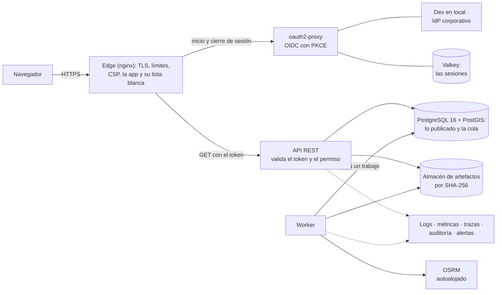
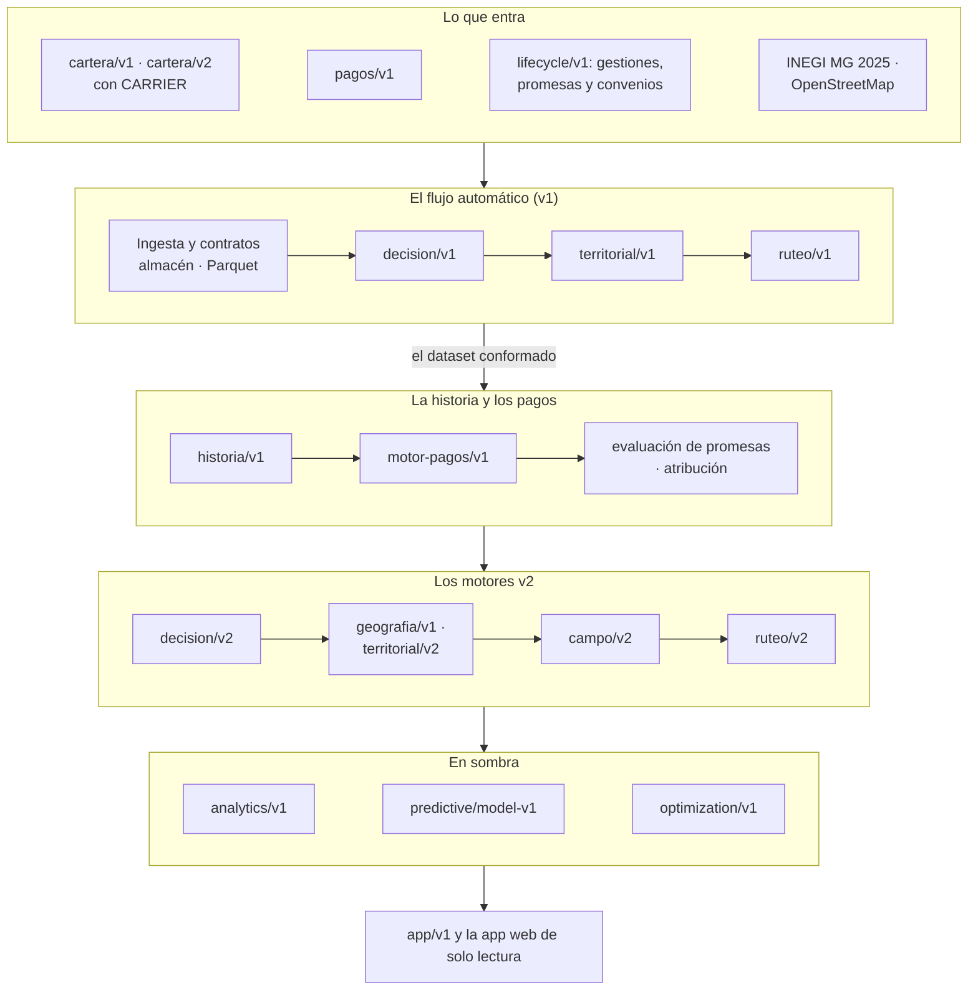

# Arquitectura

motor-cartera es un monolito modular en Python: un paquete (`src/motor_cartera`) con una API REST
(FastAPI), un worker que ejecuta cada motor desde una cola durable en PostgreSQL y una línea de
comandos, más una app web de solo lectura (`web/`). Todo el estado vive en PostgreSQL 16 con
PostGIS 3.5 y en un almacén de artefactos por contenido; el ruteo por calle lo responde un OSRM
autoalojado. Nada llama a un servicio externo en ejecución: ni geocodificación, ni mapas, ni ruteo
público.

Este documento es el mapa. El porqué de cada pieza está en [decisiones.md](decisiones.md); cada
motor, en su documento ([índice](README.md)).

## Contexto

- **Qué entra.** Archivos de cartera (`cartera/v1`, o la cartera oficial `cartera/v2` con su hoja
  CARRIER) y de pagos (`pagos/v1`), tal como los entregaría un acreedor, pero generados por el
  propio repositorio: **ningún dato real entra**. Dos referencias públicas, descargadas y
  verificadas por su SHA-256 fuera del repositorio: el Marco Geoestadístico Integrado 2025 del
  INEGI y un extracto de OpenStreetMap. Y lo que la cobranza registra por la API: gestiones,
  promesas y convenios, como eventos que solo se agregan.
- **Qué sale.** Lo que publica cada motor, inmutable y explicable hasta la fila de origen: la
  certificación de cada archivo, la historia de cada cuenta, la interpretación de los pagos, las
  decisiones, la geografía, la asignación territorial, el plan de campo, las rutas, los agregados
  de analytics, las predicciones y los planes óptimos. Se consulta por la API, la línea de
  comandos, sus exportaciones y la app.
- **Quién lo usa.** En producción, personas que inician sesión con OpenID Connect y servicios con
  su clave, cada uno con sus permisos; en el compose de desarrollo, una sola clave de servicio.

## Componentes

| Componente | Qué hace | Dónde |
|---|---|---|
| API | La API REST: registra el trabajo y responde; no ejecuta ningún motor | `motor_cartera.api`, servicio `api` |
| Worker | Toma cada trabajo de la cola, ejecuta su motor y encadena la etapa siguiente | `motor-cartera worker`, servicio `worker` |
| CLI | Los mismos motores y consultas en la línea de comandos, sin pasar por la API | `motor_cartera.cli` |
| PostgreSQL 16 + PostGIS 3.5 | Todo el estado: lo publicado, la cola, la geografía | servicio `postgres` |
| Almacén de artefactos | Cada archivo original y cada Parquet conformado, por su SHA-256, de solo lectura | volumen `fuentes` |
| OSRM v26.9.0 | El ruteo por calle de `ruteo/v2`, sobre una red vial versionada | servicio `osrm` (perfil `ruteo`) |
| App web | React 19 y TypeScript estricto, servida por nginx con un proxy de solo `GET` y lista blanca | `web/`, servicio `web` |
| Edge | En producción, la única puerta: TLS, límites, cabeceras y la lista blanca hacia la API | servicio `edge` |
| Identidad | oauth2-proxy (OpenID Connect con PKCE, sesión en Valkey) y Dex en local | servicios `oauth2-proxy`, `valkey`, `dex` |
| Observabilidad | El colector de OpenTelemetry, Prometheus, Alertmanager, Grafana y Jaeger | perfil `observabilidad` |
| Respaldo | La base y el almacén juntos, verificados, y su restauración en un entorno nuevo | `scripts/respaldo.py`, perfiles `respaldo` y `restauracion` |

En el compose de producción, una petición del navegador y un trabajo del worker recorren esto:



El compose de desarrollo (`docker-compose.yml`) levanta la base, las migraciones, la API, el worker,
la app y, con su perfil, OSRM. El de producción (`docker-compose.production.yml`) agrega el edge, la
identidad, la observabilidad y el respaldo, con secretos como archivos, un rol de base por servicio
y contenedores sin raíz ([production.md](production.md)).

## El flujo de los datos



Debajo de todo corren las mismas piezas: PostgreSQL con PostGIS guarda cada capa y la cola; el
worker ejecuta cada motor como un trabajo durable; la API registra y consulta; OSRM responde las
matrices de `ruteo/v2`. A lo largo de todo, la seguridad (identidad, permisos, claves y secretos) y
la observabilidad (logs, métricas, trazas y auditoría).

El diagrama simplifica las dependencias: la geografía lee un corte y su referencia, no la
decisión; `campo/v2` junta una `decision/v2` con una `territorial/v2`; analytics lee todo lo
anterior; el predictivo, la historia, los pagos, el lifecycle y la evaluación; y la
optimización, un scoring, una `decision/v2` y, con `CAMPO`, su `ruteo/v2`.

Cada capa lee lo que la anterior **ya publicó**, con sus entradas declaradas por su identificador
(nunca «la última»), y publica todo o nada. Las que deciden con el tiempo (`decision/v2`,
analytics y predictivo) lo hacen **point-in-time**: con lo ocurrido hasta `as_of` y lo conocido en
`known_at`. Ninguna capa nueva cambia a las anteriores: los motores v1 siguen como estaban, y
`decision/v2`, `territorial/v2`, `campo/v2` y `ruteo/v2` corren en paralelo a ellos.

## La ejecución

La API no ejecuta ningún motor: cada `POST` que pide trabajo registra el recurso `EN_PROCESO` y su
trabajo en la cola, en la misma transacción, y responde `201`. Un worker lo toma con
`FOR UPDATE SKIP LOCKED`, lo retiene con un lease que renueva su latido, ejecuta el motor y, al
cerrarlo, encola la etapa siguiente en la misma transacción. Si muere, otro worker lo retoma cuando
vence el lease; la entrega es *at-least-once*, y la publicación, una sola, porque cada motor publica
todo o nada y los índices únicos admiten a lo más una ejecución `EXITOSA` por fuente y versión.
Todo eso, con sus parámetros, en [orquestacion.md](orquestacion.md).

## El almacenamiento

- **PostgreSQL 16 con PostGIS 3.5**: cada capa en sus tablas, con el esquema creado por las
  migraciones de Alembic (`migraciones/`). Lo publicado no se reescribe: el lifecycle solo agrega
  (un trigger rechaza `UPDATE` y `DELETE`), triggers hacen inmutable lo que publican la geografía,
  `territorial/v2`, `campo/v2`, `ruteo/v2`, predictivo y optimización, y una corrección es otra
  versión, otra ejecución o un evento que anula.
- **El almacén de artefactos**, un directorio por contenido: cada archivo original y cada dataset
  conformado (Parquet, reproducible byte por byte) por su SHA-256, escrito de forma atómica y de
  solo lectura, que no se borra nunca ([fuentes.md](fuentes.md)).
- **El linaje**, en la base: de cada resultado a su ejecución, de cada ejecución a sus entradas, y
  de cada snapshot o pago a su dataset, su fila y su archivo original (abajo, con el código).

## La frontera de seguridad

En producción el edge es el único contenedor con puertos: TLS 1.2/1.3, HSTS, CSP sin
`unsafe-inline` ni `unsafe-eval`, límites por IP, y solo los `GET` de su lista blanca hacia la API.
Las personas inician sesión con OpenID Connect y PKCE por oauth2-proxy (Dex en local, el IdP
corporativo en un despliegue), con la sesión del lado del servidor y ningún token en el navegador.
La API valida cada token ella misma y autoriza cada operación por una matriz explícita de cuatro
permisos que verifica al arrancar; los servicios usan claves guardadas por su hash. La configuración
falla cerrada: sin OIDC, sin el secreto del gateway o con la clave de desarrollo, la API de
producción no arranca. Detalle en [security.md](security.md), [threat-model.md](threat-model.md) y
[matriz-autorizacion.md](matriz-autorizacion.md).

El compose de desarrollo no tiene usuarios: una clave de servicio que pone el proxy de la app, y la
app lo dice a la vista. No se despliega así ni con datos reales.

## La observabilidad

Logs JSON redactados con `request_id` y `trace_id`, métricas de Prometheus por plantilla de ruta
(ninguna etiqueta lleva un identificador), trazas de OpenTelemetry que fallan abiertas y la
auditoría `security-audit/v1` de cada petición, con seudónimos. Las alertas tienen su umbral
inicial y su runbook, y los objetivos de servicio están escritos
([observability.md](observability.md), [slos.md](slos.md), [runbooks/](runbooks/README.md)).

## La referencia de despliegue

> **REFERENCE ARCHITECTURE — NOT DEPLOYED.** La referencia de Google Cloud existe como código
> (`infra/gcp`, en OpenTofu), se valida en cada run del CI sin credenciales y **nunca se aplicó**.

Mapea cada servicio del compose de producción a Google Cloud: un balanceador HTTPS externo con
Cloud Armor delante de un servicio de Cloud Run con tres contenedores (el edge con la app, y
oauth2-proxy y la API como sidecars); el worker en su propio servicio de Cloud Run; Cloud SQL
PostgreSQL 16 con PostGIS; Memorystore para las sesiones; Filestore para el almacén de artefactos;
OSRM en una VM de Compute Engine sin IP pública; jobs de Cloud Run para las migraciones y el
respaldo, que escribe en un bucket de GCS; Secret Manager, Artifact Registry y Workload Identity
Federation para desplegar sin llaves. Qué falta para un despliegue real, en
[cloud-gcp.md](cloud-gcp.md).

## El código y su linaje

```
src/motor_cartera/
├── config.py          Configuración desde el entorno (prefijo MC_)
├── contratos/         Qué forma deben tener los datos: cartera/v1 (cartera.py), las fuentes
│                      oficiales (fuente.py, cartera_v2.py y pagos.py) y su juicio vectorizado
├── fuentes/
│   ├── almacen.py     El almacén de artefactos por contenido (SHA-256, atómico, de solo lectura)
│   ├── artefactos.py  El artefacto en la base: primero el objeto, después su fila; la auditoría
│   ├── formatos.py    Qué es un archivo por su contenido: xlsx, csv o zip
│   ├── lotes.py       La fuente leída por lotes, con su fila y su hoja; la hoja compañera
│   ├── conformado.py  El dataset conformado en Parquet, reproducible
│   ├── geografia.py   El catálogo público del INEGI y cómo se resuelve un nombre, sin adivinar
│   └── proyeccion.py  operacional/v1: de cartera/v2 a Cuenta
├── ingesta/
│   ├── lectores.py    Excel, CSV y ZIP a nombres canónicos de cartera/v1
│   ├── corridas.py    La corrida: lee, juzga, decide y publica. La usan la API y el CLI
│   ├── fuente_oficial.py  Las dos pasadas de una fuente oficial: llaves globales y firma
│   ├── cartera_v2.py  cartera/v2: juicio, conformado, proyección y CARRIER, todo o nada
│   └── pagos.py       pagos/v1: su ingesta, su barrera y su conformado, sin deduplicar
├── atraso.py          Tramos de atraso: la única fuente de sus fronteras
├── invariantes.py     presente(): lo que el código garantiza y el verificador de tipos no ve
├── segmentacion.py    El resumen por segmento, agregado en la base
├── decision/
│   ├── reglas.py      decision/v1: el núcleo puro y determinista, sin base ni framework
│   └── ejecuciones.py Aplica el núcleo sobre PostgreSQL, en una transacción: todo o nada
├── territorial/
│   ├── reglas.py      territorial/v1: el dominio puro (carga, orden y motivos), sin base
│   └── ejecuciones.py Agrega en PostgreSQL, aplica el núcleo y persiste: todo o nada
├── ruteo/
│   ├── reglas.py      ruteo/v1: coordenadas sintéticas, distancia, vecino más cercano y 2-opt
│   └── ejecuciones.py Lee las cuentas CAMPO, aplica el núcleo y publica rutas y paradas: todo o nada
├── historia/
│   ├── identidad.py   Los identificadores públicos deterministas (UUID versión 5)
│   ├── carga.py       Del Parquet conformado a PostgreSQL: lotes, CSV de Arrow y COPY
│   ├── ejecuciones.py historia/v1: abrir con su dataset, materializar todo o nada, equivalencia
│   │                  y conflicto de cortes
│   ├── presencia.py   Primera observación, salida, reingreso y continuidad: el núcleo puro
│   ├── backfill.py    La historia de los datasets que todavía no la tienen
│   └── cuenta360.py   Lo que se consulta de una cuenta: resumen, historia, eventos y pagos
├── motor_pagos/
│   ├── reglas.py      motor-pagos/v1: el núcleo puro (grupos, clasificaciones, reversos, recuperación)
│   ├── firmas.py      Las huellas (firma exacta y llave histórica) y el movimiento_id, en Python y SQL
│   ├── ejecuciones.py Abrir las ventanas con la historia de sus pagos e interpretarlas en
│   │                  PostgreSQL, por conjuntos y todo o nada
│   ├── contexto.py    El contexto temporal de un movimiento entre los snapshots: el núcleo puro
│   ├── backfill.py    Las ventanas sin interpretación vigente, desactualizadas o por conciliar
│   └── consultas.py   Lo que se consulta: ejecuciones, resultados, movimientos, su evidencia y el
│                      resumen de pagos de una cuenta
├── lifecycle/
│   ├── reglas.py      lifecycle/v1: el vocabulario, la coherencia de una gestión, los datos
│   │                  personales y la huella de una petición, sin base
│   ├── registro.py    Una escritura con su llave de idempotencia, en una transacción
│   ├── importacion.py cargar-lifecycle: JSONL por COPY y tablas temporales, por fases, todo o nada
│   └── consultas.py   Gestiones, promesas, convenios, la línea de tiempo y el resumen de una cuenta
├── evaluacion/
│   ├── reglas.py      evaluacion-promesa/v1: el núcleo puro
│   ├── ejecuciones.py La evaluación de una cartera a una fecha, en PostgreSQL, todo o nada
│   ├── backfill.py    Las evaluaciones que faltan a una fecha (backfill-lifecycle)
│   └── consultas.py   Las evaluaciones y lo que concluyeron de cada promesa
├── atribucion/
│   ├── reglas.py      atribucion/v1: el núcleo puro (candidatas, clasificación y motivos)
│   ├── ejecuciones.py La atribución de una ventana en PostgreSQL, por conjuntos y todo o nada
│   ├── backfill.py    Las ventanas sin atribución al día (backfill-atribucion)
│   └── consultas.py   Las ejecuciones, sus resultados con sus candidatas y la última de una cuenta
├── decision_v2/
│   ├── features.py    features-decision/v1: qué features hay, su tipo, su familia y su forma
│   │                  canónica (feature_hash), sin base
│   ├── politica.py    decision-policy/public-v1 como datos, su hash y su evaluador puro
│   ├── ejecuciones.py decision/v2: abrir con as_of y known_at, asentar la frontera y decidir un
│   │                  corte point-in-time en PostgreSQL, por conjuntos y todo o nada
│   ├── consultas.py   Las ejecuciones, sus resultados, la decisión de una cuenta y su historia
│   └── sombra.py      decision/v1 contra decision/v2, sin juzgar cuál es mejor
├── geografia/
│   ├── reglas.py      geografia/v1: el vocabulario, la regla de una cuenta y la firma, sin base
│   ├── crs.py         Reconocer el sistema de coordenadas de un .prj por sus parámetros
│   ├── referencia.py  Importar una referencia pública, validada, en EPSG:4326 y todo o nada
│   ├── referencias.json  El manifiesto de las referencias oficiales, con su SHA-256
│   ├── ejecuciones.py La geografía de un corte en PostgreSQL con PostGIS, por conjuntos
│   ├── consultas.py   Las versiones, las ejecuciones, sus resultados y la geografía de una cuenta
│   ├── muestra.py     Puntos de una referencia, con PostGIS y una semilla, para el generador
│   └── sintetica.py   Capas sintéticas: las de las pruebas y la cuadrícula de la prueba de humo
├── bases/
│   └── configuracion.py  Las bases operativas: validación fail-closed, forma canónica, hash y
│                      publicación versionada
├── territorial_v2/
│   ├── politica.py    territorial-public-v2 como datos, su hash y su evaluador puro
│   ├── ejecuciones.py La asignación de un corte en PostgreSQL, por conjuntos y todo o nada
│   └── consultas.py   Las ejecuciones, sus asignaciones y las de una cuenta
├── campo_v2/
│   ├── politica.py    campo-public-v2 como datos y su hash; la cuadrícula, los identificadores,
│   │                  el ranking Rendezvous y el reparto por bloques: el núcleo puro
│   ├── configuracion.py  La configuración de campo: validación fail-closed, la jornada de un
│   │                  gestor en una fecha, forma canónica, hash y publicación versionada
│   ├── ejecuciones.py campo/v2: abrir con sus entradas declaradas y planear una fecha en
│   │                  PostgreSQL, por conjuntos y todo o nada
│   ├── consultas.py   Las configuraciones, los planes, sus asignaciones, cargas y unidades, y los
│   │                  de una cuenta
│   └── backfill.py    Los planes que faltan para una configuración y una fecha declaradas
├── ruteo_v2/
│   ├── politica.py    ruteo-public-v2 como datos y su hash; el snap, las ventanas, la secuencia,
│   │                  el 2-opt y la simulación de la jornada: el núcleo puro
│   ├── proveedor.py   El proveedor de ruteo: el cliente de OSRM (POST, reintentos, la red que
│   │                  declara el backend) y su protocolo
│   ├── red_vial.py    Las versiones de la red: la huella, la preparación, el manifiesto y su
│   │                  registro
│   ├── sintetica.py   La red vial sintética de las pruebas, la prueba de humo y el CI
│   ├── perfiles/      El car.lua de OSRM v26.9.0, tal cual, con su licencia
│   ├── ejecuciones.py ruteo/v2: abrir con sus entradas declaradas, pedir la red y rutear un plan,
│   │                  todo o nada
│   ├── consultas.py   Las redes, las ejecuciones, sus rutas y paradas, y las de una cuenta
│   └── backfill.py    Las ejecuciones que faltan sobre una red declarada
├── analytics/
│   ├── catalogo.py    analytics-metrics/public-v1: cada métrica con su definición formal, los
│   │                  conjuntos de dimensiones, el JSON canónico, el dimension_hash y el hash
│   ├── politica.py    analytics-public-v1: el mínimo por celda, los periodos y su hash
│   ├── supresion.py   La supresión primaria y complementaria de las celdas: el núcleo puro
│   ├── cobertura.py   La cobertura de pagos de cada día del horizonte
│   ├── manifiesto.py  El manifiesto: resolverlo y comprobarlo, su hash y la firma
│   ├── sql.py         El SQL por conjuntos: la cohorte, cada dominio point-in-time, los hechos
│   │                  por cuenta y periodo, las celdas con GROUPING SETS y la publicación
│   ├── controles.py   Los controles de reconciliación, exactos
│   ├── ejecuciones.py analytics/v1: abrir con su manifiesto y analizar, todo o nada
│   ├── consultas.py   El catálogo, las ejecuciones, sus agregados, su resumen, sus embudos y sus
│   │                  controles
│   └── seleccion.py   Proponer un manifiesto, con sus reglas, sin elegir lo ambiguo
├── predictivo/
│   ├── targets.py     predictive-targets/public-v1: los targets, sus ventanas, su madurez y su hash
│   ├── features.py    predictive-features/public-v1: cada feature con su fuente y su nulo, lo
│   │                  prohibido, la forma canónica, el feature_hash y el hash
│   ├── politica.py    predictive-training/public-v1: split, rejillas, calibración, compuertas,
│   │                  métricas, bootstrap, drift y su hash
│   ├── manifiesto.py  El manifiesto de un entrenamiento: leerlo, comprobarlo, su hash, la firma y
│   │                  proponer uno
│   ├── sql.py         El SQL point-in-time de las features y de los labels, por conjuntos
│   ├── construccion.py Las features (y los labels) de un corte con sus relojes, por COPY a Arrow
│   ├── dataset.py     El dataset ancla por ancla, compacto, y su dataset_hash
│   ├── preprocesamiento.py Transformación, imputación, escalado y one-hot, aprendidos de TRAIN
│   ├── glm.py         Logística L2, Tweedie y Platt por Newton (IRLS) por bloques
│   ├── metricas.py    Clasificación, calibración, monto, bootstrap por cuenta y PSI
│   ├── artefacto.py   El artefacto JSON canónico, su hash, el runtime y la cuantización
│   ├── entrenamiento.py Abrir y entrenar, con el walk-forward y la publicación todo o nada
│   ├── scoring.py     Abrir y puntuar, con los motivos, el drift y la publicación todo o nada
│   ├── drift.py       El PSI de features y salidas y el de los faltantes, contra TRAIN
│   ├── explicacion.py La explicación local verificada con el feature_hash
│   ├── desempeno.py   El desempeño de un scoring con sus labels maduros
│   ├── consultas.py   Lo que leen la API y el CLI
│   ├── escenario.py   Cargar un escenario predictivo semana por semana, con su bitácora
│   ├── candado.py     El candado de una ejecución: un advisory lock, sin transacción abierta
│   └── medicion.py    Los tiempos por fase, la memoria pico y el entorno
├── optimizacion/
│   ├── politica.py    optimization-public-v1: el valor, los objetivos, la precisión, los canales,
│   │                  los motivos y su hash
│   ├── configuracion.py optimization-config/v1: leer el esquema cerrado, la forma canónica, el
│   │                  hash, registrar y publicar
│   ├── formulacion.py El núcleo puro: el problema, el prechequeo, la reducción exacta, el modelo
│   │                  disperso, las cuatro etapas, la verificación en enteros, el diagnóstico de
│   │                  relajación y el hash del plan
│   ├── solver.py      HiGHS por SciPy: la relajación, el branch-and-bound, sus estados, los duales
│   │                  y la huella del solver
│   ├── sql.py         El universo y los pares elegibles, por conjuntos
│   ├── ejecuciones.py optimization/v1: abrir con sus entradas declaradas y optimizar, todo o nada
│   ├── exportacion.py Las asignaciones y el plan agregado en CSV, Parquet y JSONL
│   └── consultas.py   Lo que leen la API y el CLI, la explicación de una cuenta y la comparación
├── app_v1/
│   ├── contexto.py    El contexto operativo: resolver cada ejecución declarada y validar que
│   │                  exista, sea del corte y encadene con las demás
│   ├── opciones.py    Las carteras, los cortes, las ejecuciones de un corte y las sugerencias
│   ├── resumen.py     La distribución de las predicciones de un scoring, contada en la base
│   ├── cuentas.py     El explorador: las llaves de la página primero, después su detalle
│   └── linaje.py      De dónde salió cada resultado: cada ejecución y lo que declaró que leyó
├── seguridad/
│   ├── permisos.py    Los cuatro permisos, los roles y el principal de una petición
│   ├── tokens.py      Los tokens de OpenID Connect, validados con su JWKS
│   └── credenciales.py  Las claves de los servicios (por su hash) y los secretos del gateway
├── observabilidad/
│   ├── logs.py        Los logs JSON de producción, con campos fijos y redactados
│   ├── metricas.py    Las métricas de Prometheus de la API y del worker, sin identificadores
│   ├── trazas.py      Las trazas de OpenTelemetry, que fallan abiertas
│   └── auditoria.py   El evento de auditoría security-audit/v1, con seudónimos
├── orquestacion/
│   ├── cola.py        La cola durable: tomar con SKIP LOCKED, lease, latido, devolver y cerrar
│   ├── worker.py      El worker: ejecuta cada trabajo con su latido y lo cierra con lo que sigue
│   ├── flujo.py       El flujo automático: encola, encadena las etapas, detiene y reanuda
│   └── objetivos.py   El recurso de cada tipo de trabajo y sus estados terminales
├── db/                Modelo: la corrida, sus cuentas y rechazos, las ejecuciones con lo que
│                      publican (decisiones por cuenta, resultados por municipio, rutas y paradas),
│                      la orquestación (flujos y trabajos), la evidencia (artefactos, datasets
│                      conformados, hojas compañeras e ingestas de pagos con sus rechazos) y el
│                      modelo histórico (cuentas canónicas, cortes, snapshots, pagos observados
│                      y sus ejecuciones), el motor de pagos (sus ejecuciones, un resultado por
│                      observación y los movimientos canónicos), el lifecycle (eventos, gestiones,
│                      visitas, promesas, convenios y cuotas), la evaluación de promesas, la
│                      atribución (sus ejecuciones, sus resultados y sus candidatas), decision/v2
│                      (sus ejecuciones, las features y la decisión de cada cuenta), la geografía
│                      (versiones de la referencia, municipios, ejecuciones y resultados), las
│                      bases operativas, territorial/v2 (ejecuciones y asignaciones), campo/v2
│                      (la configuración de campo, los planes, sus asignaciones, sus unidades y
│                      la carga de cada gestor), ruteo/v2 (las versiones de la red vial, las
│                      ejecuciones, la ruta de cada gestor y cada parada), analytics/v1 (las
│                      ejecuciones con su manifiesto, sus agregados y sus controles) y
│                      predictive/model-v1 (los entrenamientos con sus anclas y sus
│                      interpretaciones, las versiones del modelo con sus componentes, los
│                      scorings, sus predicciones y su drift) y optimization/v1 (las
│                      configuraciones con su admisibilidad, sus pools y sus restricciones, las
│                      ejecuciones, el resultado de cada cuenta, el uso de cada pool y cada
│                      restricción)
├── generador/         Único origen de datos del proyecto: la cartera de cartera/v1 (sintetico.py),
│                      las fuentes oficiales, sus perfiles y el escenario longitudinal (oficial.py),
│                      el lifecycle sintético de cada periodo del escenario (lifecycle.py), la
│                      configuración de campo sintética (campo.py) y el escenario predictivo con
│                      señal pública (predictivo.py)
├── api/               FastAPI: corridas, pagos, orquestación, cartera, decisiones, territorial,
│                      ruteo, cuentas (Cuenta 360), historia, motor de pagos, movimientos,
│                      gestiones, acuerdos (promesas y convenios), lifecycle, evaluaciones,
│                      atribuciones, decisiones v2, geografía, bases, territorial v2, la
│                      configuración de campo, campo v2, ruteo v2, analytics, predictivo,
│                      optimización y app/v1 (la fachada de solo lectura de la app, con sus
│                      modelos sin datos personales);
│                      subidas, esquemas, errores y autenticación
└── cli.py             Comandos: generar, generar-oficial, generar-escenario, cargar, cargar-pagos,
                       cargar-lifecycle, verificar-fuentes, backfill-historia,
                       backfill-motor-pagos, backfill-lifecycle, backfill-atribucion, decidir-v2,
                       comparar-decisiones, generar-geografia-sintetica, importar-geografia,
                       muestrear-puntos, geolocalizar, cargar-bases, asignar-territorial-v2,
                       cargar-campo, generar-campo-sintetico, planificar-campo-v2,
                       resumen-campo-v2, backfill-campo-v2, exportar-plan-campo,
                       generar-red-sintetica, preparar-red-vial, registrar-red-vial, rutear-v2,
                       resumen-ruteo-v2, backfill-ruteo-v2, construir-manifiesto-analytics,
                       analizar-cobranza, resumen-analytics, exportar-analytics,
                       backfill-analytics, generar-escenario-predictivo,
                       cargar-escenario-predictivo, construir-manifiesto-predictivo,
                       entrenar-predictivo, resumen-modelo-predictivo, score-predictivo,
                       drift-predictivo, evaluar-predictivo, crear-config-optimizacion,
                       optimizar-cartera, resumen-optimizacion, exportar-optimizacion,
                       diagnosticar-optimizacion, comparar-optimizaciones y worker
migraciones/           Versiones de Alembic
scripts/               Prueba de humo, control de archivos trackeados, benchmarks de escala, del
                       modelo histórico, del motor de pagos, del lifecycle, de decision/v2, de la
                       geografía, de campo/v2, de ruteo/v2, de analytics/v1, de
                       predictive/model-v1, de optimization/v1 y de la app, actualización del
                       catálogo del INEGI, y el contrato y las capturas de la app web
docs/                  La documentación, con su índice en docs/README.md
infra/                 La configuración del compose de producción (edge, Dex, PostgreSQL,
                       respaldo, carga con k6, observabilidad) y la referencia de Google Cloud
                       en OpenTofu (gcp/), nunca aplicada
web/                   La app de solo lectura: la SPA (src/), su proxy (nginx/ y proxy-api.ts),
                       sus pruebas (src/**/*.test.ts* y e2e/), su Dockerfile y sus scripts
```

Todo lo que se escribe cuelga de una **Corrida**. Si alguien pregunta de dónde salió un
número, la respuesta es una fila de esa tabla: qué archivo llegó (con su firma SHA-256) y
qué cartera traía (con la firma de su contenido, la misma en cualquier formato), con qué
tolerancia y qué versión del contrato se juzgó, cuántos registros se leyeron, validaron y
rechazaron, y por qué.

Desde v0.6.0, la corrida apunta a su **ArtefactoFuente**: los bytes exactos que llegaron, en el
almacén. Una corrida de cartera/v2 tiene además su **DatasetConformado** (el Parquet de sus
registros válidos, otro artefacto) y su **HojaCompanera** (la auditoría de CARRIER). Los pagos
cuelgan de una **IngestaPagos**, que no es una corrida: apunta a su artefacto, tiene sus rechazos,
su conformado y su trabajo en la cola, y no publica cuentas. Del artefacto al conformado y del
conformado a cada fila de origen, el linaje está en la base y en cada registro.

Las decisiones cuelgan de una **EjecucionDecision**, y la ejecución, de la corrida que decidió.
Si alguien pregunta por qué a una cuenta se le recomienda `CAMPO`, la respuesta son sus motivos
y una fila de esa tabla: con qué versión de las reglas se decidió, cuándo, cómo terminó y
cuántas cuentas evaluó y publicó. Cada capa hace una sola cosa: `reglas.py` decide una cuenta
sin saber de bases ni de HTTP, `ejecuciones.py` aplica ese núcleo a toda la corrida y publica
todo o nada, y `api/decisiones.py` solo traduce el resultado a HTTP.

Los resultados por municipio cuelgan de una **EjecucionTerritorial**, y esta, de la ejecución de
decisión que organizó, no de la corrida: una corrida se puede decidir con varias versiones de las
reglas, y lo territorial tiene que decir exactamente de qué decisiones salió. Las capas se
repiten: `territorial/reglas.py` es el dominio puro, que evalúa y ordena municipios ya
agregados; `territorial/ejecuciones.py` agrega en PostgreSQL, aplica ese núcleo y persiste todos
los municipios o ninguno, en una transacción; y `api/territorial.py` solo traduce a HTTP.

Las rutas cuelgan de una **EjecucionRuteo**, y esta, de la ejecución territorial que ruteó:
`Corrida → EjecucionDecision → EjecucionTerritorial → EjecucionRuteo → RutaTerritorial →
ParadaRuta`. Cada ruta apunta al `ResultadoTerritorial` de su municipio y cada parada a la
`DecisionCuenta` que visita; la clave del municipio y el cliente se leen por JOIN, no se copian.
`ruteo/reglas.py` calcula las coordenadas sintéticas, la distancia, el vecino más cercano y el
2-opt sin saber de bases; `ruteo/ejecuciones.py` obtiene las cuentas `CAMPO` en una sola consulta,
aplica el núcleo municipio por municipio y publica todas las rutas y paradas o ninguna; y
`api/ruteo.py` solo traduce a HTTP.

La orquestación cuelga de esos mismos recursos sin cambiarlos. Un **FlujoOrquestacion** por cada
corrida subida por la API apunta a la ejecución de cada etapa a la que llegó; un
**TrabajoOrquestacion** por recurso dice qué motor ejecutar, quién lo tiene, hasta cuándo y cuántas
veces se intentó; y el **ArchivoCorrida**, que desde v0.6.0 solo conserva el archivo de las corridas
que v0.5 dejó en la cola.
`orquestacion/` no sabe qué calcula cada motor: llama a su servicio y lee el estado de su recurso.
Por eso v0.5.0 no cambió `cartera/v1`, `decision/v1`, `territorial/v1` ni `ruteo/v1`.

El modelo histórico cuelga de los datasets conformados, no de las corridas: cada
**EjecucionHistoria** materializa un dataset, y un **CorteCanonico** dice de qué dataset salió.
`CuentaCanonica → SnapshotCuenta → CorteCanonico → EjecucionHistoria → DatasetConformado →
ArtefactoFuente (Parquet) → ArtefactoFuente (original)`: cada snapshot guarda su `source_row` y su
`source_sheet`, y cada **PagoObservado**, su dataset y su fila. `CuentaCanonica` no es `Cuenta`: esta
sigue siendo la foto operacional de una corrida, la única que leen los motores v1. `historia/`
tampoco sabe de la cola: `orquestacion/` ejecuta su trabajo `HISTORIA` como el de cualquier motor.

El motor de pagos cuelga de los pagos observados, sin cambiarlos: cada **EjecucionMotorPagos**
interpreta una ventana, y lo que concluye se explica hasta la fuente:
`MovimientoEconomicoCanonico → ResultadoPagoObservado → PagoObservado → DatasetConformado →
IngestaPagos → ArtefactoFuente (original)`, y del movimiento a su `CuentaCanonica` y a sus
snapshots. `motor_pagos/reglas.py` es el núcleo puro, `motor_pagos/ejecuciones.py` aplica las
mismas reglas en PostgreSQL por conjuntos, y `api/motor_pagos.py` y `api/movimientos.py` solo
traducen a HTTP. Ningún motor v1 lee los movimientos.

El lifecycle cuelga de las cuentas canónicas, no de una fuente: cada **EventoLifecycle** es de una
`CuentaCanonica`, y su detalle (**GestionCobranza**, **VisitaCampo**, **PromesaPago**,
**ConvenioCobranza**, **CuotaConvenio**) cuelga del evento que lo registró. Una evaluación
(**EjecucionEvaluacionPromesas** → **EvaluacionPromesa**) y una atribución (**EjecucionAtribucion**
→ **AtribucionMovimiento** → **CandidatoAtribucion**) leen el lifecycle y los movimientos del motor
de pagos sin cambiarlos: `AtribucionMovimiento → GestionCobranza → EventoLifecycle → CuentaCanonica`,
y `→ MovimientoEconomicoCanonico → ResultadoPagoObservado → PagoObservado → DatasetConformado →
ArtefactoFuente`. Los núcleos puros (`lifecycle/reglas.py`, `evaluacion/reglas.py`,
`atribucion/reglas.py`) no saben de la base, y una prueba compara cada uno con su SQL.

La geografía cuelga de un corte canónico y de una versión de la referencia, que es su otra entrada:
`ResultadoGeografiaCuenta → EjecucionGeografia → (CorteCanonico, DatasetConformado,
VersionGeografia)`, y cada resultado, de su `SnapshotCuenta` y de su `MunicipioGeografico`. Una
asignación de `territorial/v2` cuelga del resultado geográfico de su cuenta, por su llave natural
(ejecución de geografía, cuenta), y de la versión de bases de su ejecución:
`AsignacionTerritorialV2 → EjecucionTerritorialV2 → (EjecucionGeografia, VersionBasesOperativas)` y
`→ BaseOperativa → CoberturaBaseMunicipio`. Ningún motor anterior lee nada de esto: `territorial/v1`
y `ruteo/v1` siguen como estaban.
